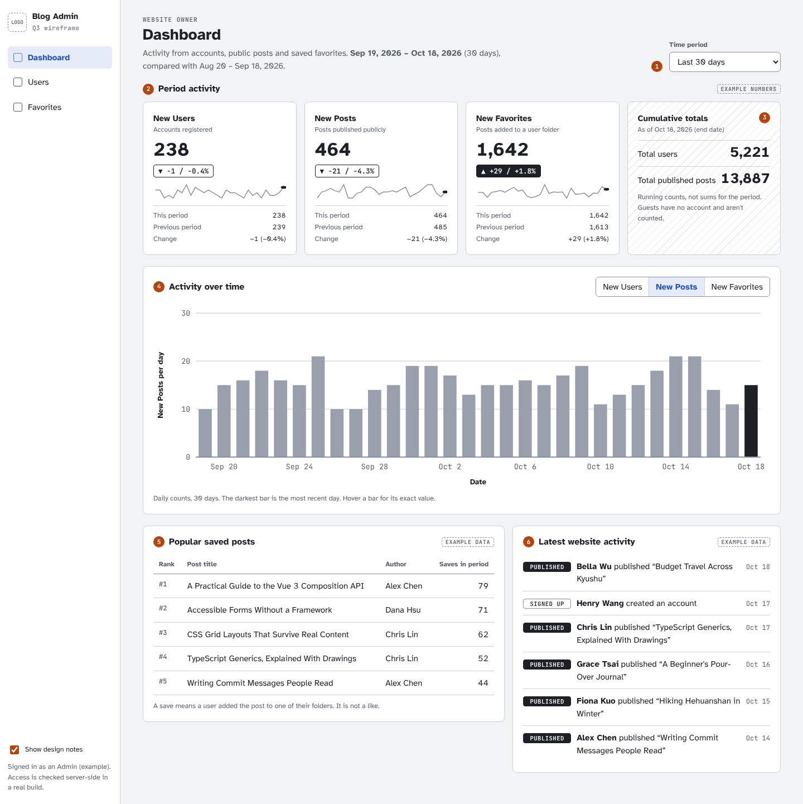
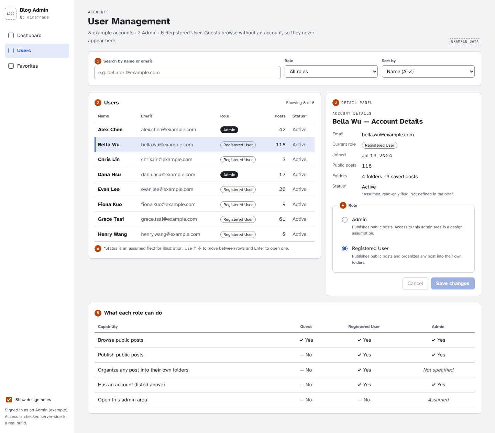
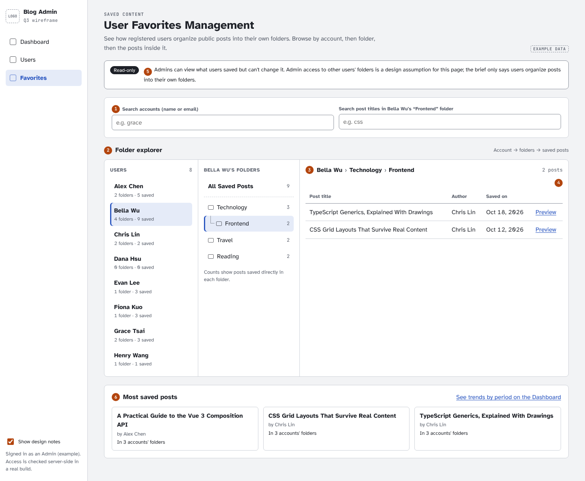

# Q1

### Vue 3 優點（Pros）

1. Proxy 響應式：改善 Vue 2 新增、刪除物件屬性無法自動追蹤的限制。
2. Composition API：相關狀態與邏輯可以集中管理，方便抽成 Composable（類似 React Hooks）。
3. TypeScript 支援：更容易定義元件 Props、Emits 與 Composable 的型別契約。
4. 效能優化：透過編譯器優化，減少不必要的 DOM 更新。

### Vue 3 缺點（Cons）

1. 響應式學習成本：`ref`、`reactive` 使用方式不同，解構可能造成響應式失效。
2. 狀態變更難追蹤：多個 Composable 共用可變狀態時，容易不清楚誰修改了資料。
3. Watcher 副作用：`watch`、`watchEffect` 若管理不當，容易產生重複請求、非同步競態問題。
4. 遷移成本：Vue 2 升級 Vue 3，需要處理舊套件相容性與既有業務邏輯。

# Q2. 使用者資料管理系統

線上 demo：<https://mawchu.github.io/user-data-management/>（網址加 `?size=5000` 會開得比較快）。各項決定的考量記在 [docs/adr/](docs/adr/README.md)。

### a. 實作

使用 Vue 3 + TypeScript 完成新增、刪除、更新、搜尋、排序、釘選與無限捲動。因為沒有實際 API，我另外用 Web Worker 寫了一個能處理一千萬筆資料的 mock 後端。

主要處理幾個問題：

- 請求管理：搜尋防抖 300ms、取消舊請求、快取 30 秒，API 失敗後停止自動載入，避免一直重送。
- 大量資料：每次載入 500 筆，用 Keyset Cursor 避免資料增刪造成漏筆；虛擬捲動搭配 DOM 回收，減少渲染成本。
- 資料一致性：釘選在前端合併，不修改原始排序；多人修改則用 Version 檢查，遇到 409 讓使用者決定怎麼處理。

### b. 搜尋請求從每分鐘 5 次增加到 500 次

先確認請求增加的原因，不一定是異常流量，也可能是使用者變多。

前端已經做了搜尋防抖、取消舊請求和快取。另外，重新檢查時發現 API 失敗會一直觸發重送，反而自己製造流量，這部分已經修正。

如果是正常使用量增加，就需要後端配合查詢和快取優化。

### c. RAM 使用量過高

目前用虛擬捲動和 DOM 回收控制畫面上的元素數量，搭配 `shallowRef` 減少響應式開銷。

但一直往下捲，已載入的資料還是會累積。後續考慮只保留最近約 5,000 筆，往回捲時重新查詢，這部分還沒實作。

# Q3. Blog Admin 後台設計

### 1. Dashboard

可以選擇特定時間區間，比較本期與上期的使用者、文章及收藏變化，同時參考累計總數，快速了解網站的整體情況。

### 2. User Management

可以搜尋使用者、查看身分與權限。點擊列表後，詳細資訊會顯示在右側，不需要離開列表，就能查看文章數量或調整權限。

### 3. Favorites Management

依照「使用者 → 資料夾 → 收藏文章」的方式呈現，沿用大家熟悉的資料夾操作習慣，方便逐層查看內容，也能快速了解哪些文章最受歡迎。
